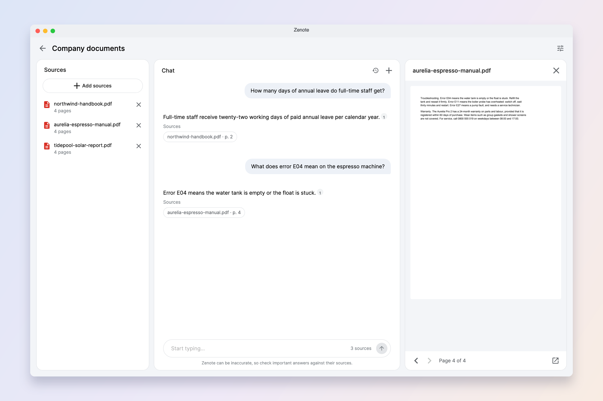
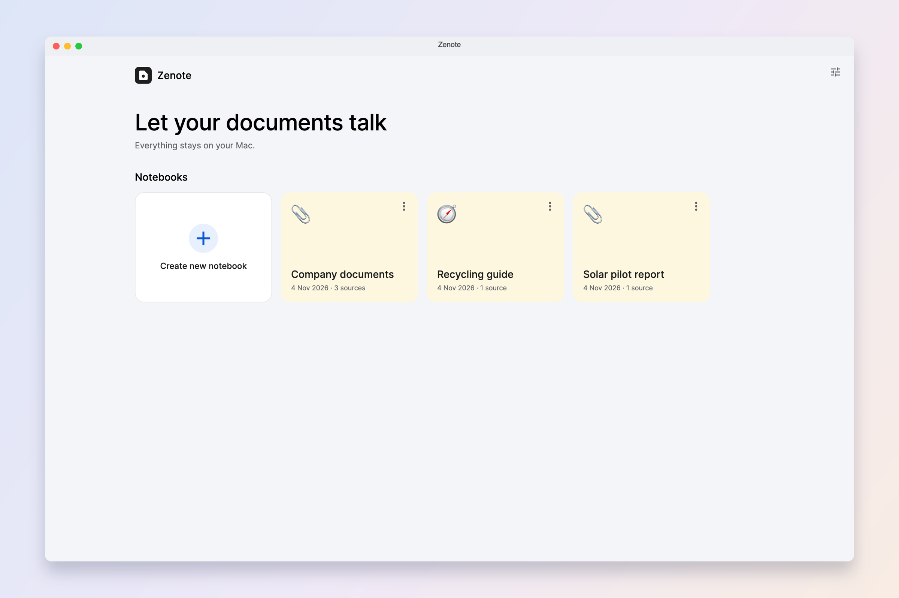
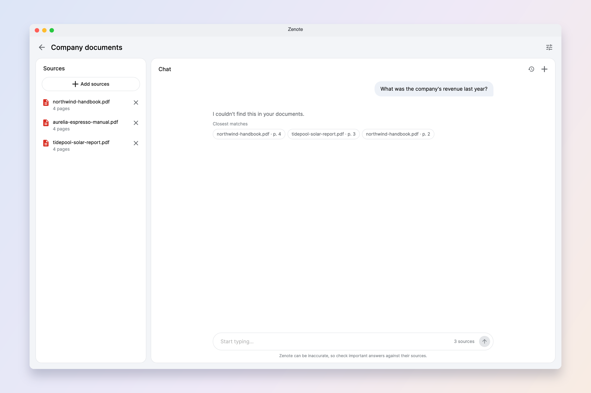
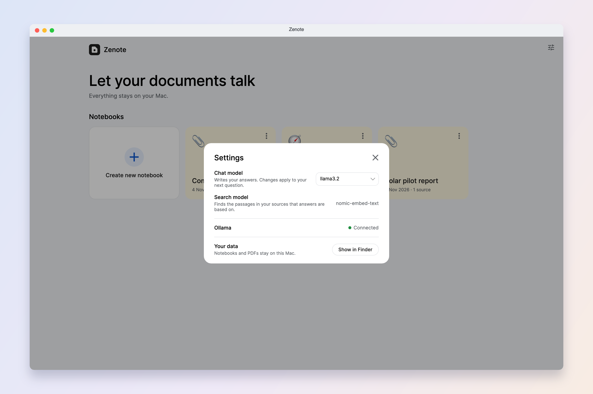
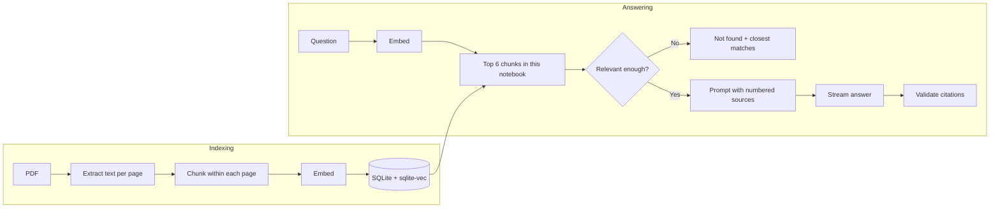
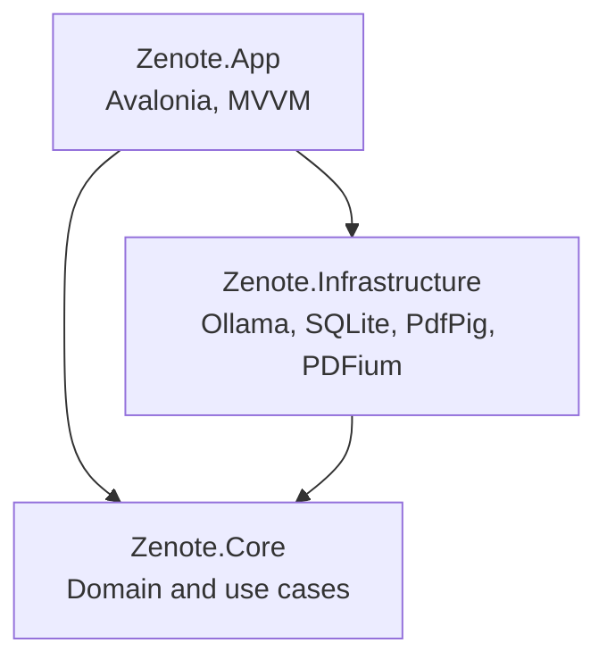

<p align="center">
  
</p>

<h1 align="center">Zenote</h1>

<p align="center"><strong>Let your documents talk.</strong><br>
Ask your PDFs questions and get answers that show the exact page they came from.<br>
Free, and everything stays on your Mac.</p>

<p align="center">
  <a href="https://github.com/zenwyn-naicker/zenote/releases/latest/download/Zenote.dmg"><strong>Download for Mac</strong></a>
</p>



> Inspired by Google's NotebookLM; not affiliated with Google.

## What it does

- **Keep notebooks:** group PDFs by topic. Each notebook has its own sources and chats.
- **Ask in plain language:** answers come only from your documents, and you can stop them at any time.
- **Check every answer:** click a citation to see the exact PDF page it came from.
- **Know when there's no answer:** if your documents don't cover something, Zenote says so and shows the closest pages.
- **Pick up where you left off:** chats are saved, follow-up questions work, and any message copies in one click.

| Your notebooks | When the answer isn't there | Simple settings |
|---|---|---|
|  |  |  |

## Install Zenote

You'll need a Mac with Apple Silicon (M1 or newer), about 5 GB of free space, and internet for the first setup. It takes about 10 minutes, mostly waiting for downloads. You won't need Terminal or an account.

**1. Install Zenote**

1. [Download Zenote.dmg](https://github.com/zenwyn-naicker/zenote/releases/latest/download/Zenote.dmg) and open it.
2. Drag **Zenote** onto the **Applications** folder.

**2. Open it for the first time**

Zenote is a free project and isn't registered with Apple, so macOS blocks it the first time. You only need to do this once:

1. Open Zenote from Applications. When macOS warns you, click **Done**.
2. Open **System Settings**, then **Privacy & Security**.
3. Scroll down to the message about Zenote and click **Open Anyway**.
4. Enter your Mac password if asked, then click **Open Anyway** again.

**3. Install Ollama**

Ollama is the free app that runs the AI on your Mac, so your documents never leave it.

1. Click **Open Ollama** in the yellow bar at the top of Zenote. If Ollama isn't installed yet, this opens its download page.
2. Download Ollama, move it to Applications and open it. You don't need to sign in.
3. Back in Zenote, click **Check again**.

**4. Download the AI models**

Click **Download models** in the yellow bar and wait for it to finish. It's a one-time download of about 2.3 GB.

**5. Start asking**

1. Click **Create new notebook**.
2. Drag in a PDF, or click **Add sources**.
3. When it's finished reading, ask a question about it.

## If something goes wrong

| What you see | What to do |
|---|---|
| Yellow bar says Zenote needs Ollama | Click **Open Ollama**. It needs to be running whenever you use Zenote, and you'll see its llama icon in the menu bar. |
| "Looks scanned. Text search won't work." | The PDF is a picture of a page. Zenote can show it but can't read it. |
| "I couldn't find this in your documents." | Try asking something more specific, or name the document in your question. |
| The first answer is slow | The AI is loading. Later answers are quicker. |

## Your privacy

- Your PDFs and chats are stored only on your Mac, in a folder only your account can open.
- The AI runs on your Mac through Ollama. Zenote has no accounts, tracking or analytics.
- Zenote only connects to Ollama on your own Mac. The internet is only used to download Ollama and its models.
- Models that run in the cloud are left out of the model list, so document text isn't sent to them. If Ollama is set up on another computer, Zenote warns you.

Answers come from a small AI model and can be wrong, so check important ones against the cited page.

---

# For developers

## How it works



The design choices that matter most:

- **Chunks never cross pages.** Each chunk is about 400 tokens with 15% overlap, split at paragraph and sentence breaks. Staying inside a page means every citation points to exactly one page.
- **Two layers of grounding.** A relevance gate skips the model when nothing retrieved is close enough. If the model is called, it's told to answer only from numbered sources, or to reply with a signal that the app turns into "not found".
- **Citations are validated.** Source numbers the model invents are removed. An answer with no valid citation is flagged and lists the pages the model was given, so it can still be checked.
- **Follow-ups without an extra model call.** Search uses the previous question plus the new one, which avoids a slow query-rewriting step on a small model.

### Architecture



Core depends only on abstractions, including `IChatClient` from Microsoft.Extensions.AI. Moving to Azure OpenAI would be a change to Infrastructure alone.

## Evaluation

Retrieval and answers are measured against 26 answerable and 8 unanswerable questions over 4 documents written for this project.

**Embedding models**

| Model | Hit@1 | Hit@3 | Hit@6 | MRR | Eval time | Loaded size |
|---|---|---|---|---|---|---|
| **`nomic-embed-text`** (used) | 88% | 100% | 100% | 0.936 | 1.6 s | 335 MB |
| `qwen3-embedding:0.6b` | 88% | 100% | 100% | 0.936 | 8.8 s | 1.2 GB |

Both ranked equally well here, so the smaller and faster model stayed.

**Chat models** (all with Zenote's prompt, gate and citation checks)

| Model | Correct fact | Cites the right page | Declined unanswerable | First word | Download |
|---|---|---|---|---|---|
| **`llama3.2`** (default) | 96% | 92% | 8 of 8 | 2.2 s | 2.0 GB |
| `qwen3.5:4b` | 96% | 96% | 8 of 8 | 2.7 s | 4.0 GB |
| `gemma4:e4b` | 96% | 96% | 8 of 8 | 3.4 s | 9.5 GB |
| `phi4-mini` | 96% | 81% | 8 of 8 | 2.9 s | 2.5 GB |

The gaps on 26 questions are only a few answers, and the first-word times are rough because other work ran alongside them. `llama3.2` stayed as the default for being the smallest and fastest, and you can switch model in Settings at any time.

These documents are small and synthetic, and the fact check is a simple keyword match. Treat the numbers as a regression check, not a benchmark.

## What I deliberately left out

| Left out | Why |
|---|---|
| Hybrid keyword search | Retrieval already found the right page in the top 3 every time. Worth adding if exact codes or names start being missed. |
| LLM query rewriting | An extra model call per follow-up, when joining the two questions works. |
| Reranking and result merging | With page-sized chunks and 6 results, there's little left to gain. |
| Audio overviews, study guides, mind maps | Zenote is the simple core: grounded chat with citations. |

## Build from source

You'll need the [.NET 10 SDK](https://dotnet.microsoft.com/download) and [Ollama](https://ollama.com/download).

```bash
dotnet run --project src/Zenote.App
```

To print a health check without opening a window:

```bash
dotnet run --project src/Zenote.App -- --self-check
```

To build `build/Zenote.app` and the `build/Zenote.dmg` installer:

```bash
./scripts/package-macos.sh
```

The app is ad-hoc signed rather than notarised, because notarising needs a paid Apple Developer account. That's why macOS shows a warning on first launch.

## Configuration

**Settings** (top right) switches the chat model between any you've pulled with Ollama. Defaults, including the Ollama address, live in `src/Zenote.App/appsettings.json`. Changing the embedding model there rebuilds the index on the next launch.

Data is stored in `~/Library/Application Support/Zenote`. Unexpected errors are written to `errors.log` there.

## Keyboard shortcuts

| Shortcut | Action |
|---|---|
| ⌘O | Add PDFs |
| ⌘N | New chat |
| ⌘. | Stop the answer |
| Return | Send |

## Performance

Measured on a 16 GB Apple Silicon MacBook Air.

| Measure | Result |
|---|---|
| App start | 0.2 to 0.6 s |
| Read a 500-page PDF | 0.8 s |
| Index a 68-page PDF | About 5 s |
| Search across 50,000 chunks | 49 ms |
| First word of an answer (model loaded) | About 2 s |
| Memory for both models | About 3.4 GB |

## Security

- SQL uses parameters. Text is only built into SQL from constants and numbers.
- PDFs are treated as untrusted: files over 500 MB are refused, damaged files are rejected before they're stored, and the prompt tells the model to ignore instructions inside sources. A test PDF containing such an instruction was obeyed 0 times out of 5, though prompt rules alone can't guarantee this.
- The model has no tools and can't take actions, so the worst a malicious PDF can do is mislead an answer.
- Answers are shown as plain text, never as HTML.
- The data folder is readable only by the current user.
- Dependencies are checked with `dotnet list package --vulnerable --include-transitive`.

## Tests

```bash
dotnet test --solution Zenote.slnx
```

Tests needing Ollama skip themselves when it isn't running. CI runs on macOS without it.

The full answer eval takes a few minutes, so it's opt-in. Its report is written to your temp folder:

```bash
ZENOTE_EVAL_ANSWERS=1 dotnet test --solution Zenote.slnx
```

## Limitations

- No OCR, so scanned PDFs are flagged but can't be searched
- Text only: tables and figures aren't understood
- Summaries only see the 6 passages retrieved, so they work best when the request names a document, and can miss parts of a long one
- On broad questions small models tend to cite every source, including ones they didn't really use
- Reading order on complex layouts depends on how the PDF was made
- Only tested on one 16 GB Mac so far

## Built with

[.NET 10](https://dotnet.microsoft.com), [Avalonia](https://avaloniaui.net), [CommunityToolkit.Mvvm](https://github.com/CommunityToolkit/dotnet), [Microsoft.Extensions.AI](https://learn.microsoft.com/dotnet/ai/microsoft-extensions-ai), [OllamaSharp](https://github.com/awaescher/OllamaSharp), [PdfPig](https://github.com/UglyToad/PdfPig), [PDFtoImage](https://github.com/sungaila/PDFtoImage), [sqlite-vec](https://github.com/asg017/sqlite-vec) and [Ollama](https://ollama.com).

Models: [Llama 3.2](https://www.llama.com) (Built with Llama) and [nomic-embed-text](https://www.nomic.ai).

Planned and built with [Claude Code](https://claude.com/claude-code) as a pair programmer. Commits it helped with are marked as co-authored.
