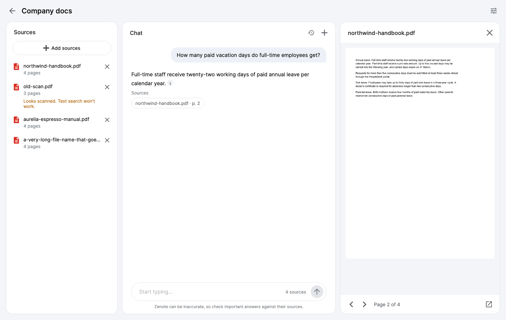
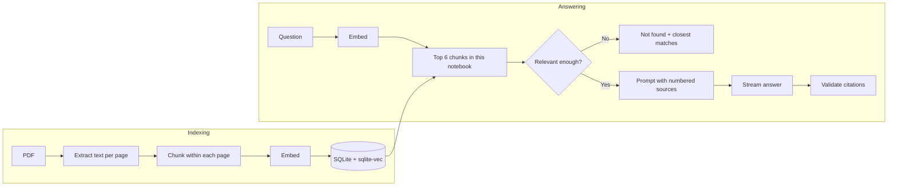
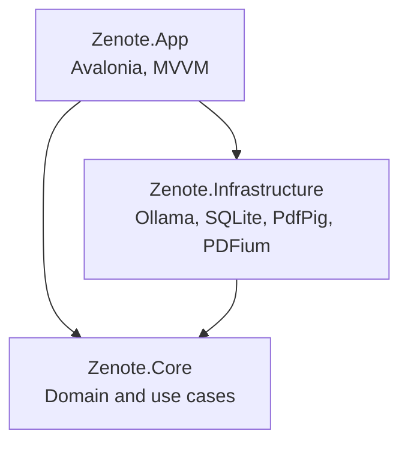

# Zenote

**Let your documents talk.** A simpler, cleaner, fully local take on NotebookLM for macOS.

Group PDFs into notebooks, ask questions in plain language, and get streamed answers that cite the exact file and page. Everything runs on your Mac. Your documents never leave it, and it costs nothing to run.



> A learning project, built to practise retrieval-augmented generation and clean .NET architecture.
> Inspired by Google's NotebookLM; not affiliated with Google.

## Features

- **Notebooks**: each has its own sources and chats, and questions only search that notebook
- **PDF import**: drag and drop, with per-document indexing progress, cancel and retry
- **Streamed answers**: grounded only in your sources, and you can stop them at any time
- **Clickable citations**: inline numbers and file-and-page chips open the rendered PDF page
- **Honest "not found"**: when your sources don't cover a question, Zenote says so and shows the closest matches
- **Saved conversations**: follow-up questions work, and chats survive a restart
- **Scanned PDF warning**: image-only documents are flagged rather than silently failing

## How it works



The design choices that matter most:

- **Chunks never cross pages.** Each chunk is about 400 tokens with 15% overlap, split at paragraph and sentence breaks. Staying inside a page means every citation points to exactly one page.
- **Two layers of grounding.** A relevance gate skips the model when nothing retrieved is close enough. If the model is called, it's told to answer only from numbered sources, or to reply with a signal that the app turns into "not found".
- **Citations are validated.** Source numbers the model invents are removed, and an answer with no valid citation is labelled unverified.
- **Follow-ups without an extra model call.** Search uses the previous question plus the new one, which avoids a slow query-rewriting step on a small model.

### Architecture



Core depends only on abstractions, including `IChatClient` from Microsoft.Extensions.AI. Moving to Azure OpenAI would be a change to Infrastructure alone.

## Evaluation

Retrieval and answers are measured against 26 answerable and 8 unanswerable questions over 4 documents written for this project.

**Embedding models**

| Model | Hit@1 | Hit@3 | Hit@6 | MRR | Eval time | Loaded size |
|---|---|---|---|---|---|---|
| **`nomic-embed-text`** (used) | 88% | 100% | 100% | 0.936 | 1.6 s | 335 MB |
| `qwen3-embedding:0.6b` | 88% | 100% | 100% | 0.936 | 8.8 s | 1.2 GB |

Both ranked equally well here, so the smaller and faster model stayed.

**Chat models** (all with Zenote's prompt, gate and citation checks)

| Model | Correct fact | Cites the right page | Declined unanswerable | First word | Download |
|---|---|---|---|---|---|
| **`llama3.2`** (default) | 96% | 92% | 8 of 8 | 2.2 s | 2.0 GB |
| `qwen3.5:4b` | 96% | 96% | 8 of 8 | 2.7 s | 4.0 GB |
| `gemma4:e4b` | 96% | 96% | 8 of 8 | 3.4 s | 9.5 GB |
| `phi4-mini` | 96% | 81% | 8 of 8 | 2.9 s | 2.5 GB |

The gaps on 26 questions are only a few answers, and the first-word times are rough because other work ran alongside them. `llama3.2` stayed as the default for being the smallest and fastest, and you can switch model in Settings at any time.

These documents are small and synthetic, and the fact check is a simple keyword match. Treat the numbers as a regression check, not a benchmark.

## What I deliberately left out

| Left out | Why |
|---|---|
| Hybrid keyword search | Retrieval already found the right page in the top 3 every time. Worth adding if exact codes or names start being missed. |
| LLM query rewriting | An extra model call per follow-up, when joining the two questions works. |
| Reranking and result merging | With page-sized chunks and 6 results, there's little left to gain. |
| Audio overviews, study guides, mind maps | Zenote is the simple core: grounded chat with citations. |

## Getting started

You'll need an Apple Silicon Mac, the [.NET 10 SDK](https://dotnet.microsoft.com/download) and [Ollama](https://ollama.com/download).

```bash
ollama pull llama3.2
ollama pull nomic-embed-text
```

Make sure Ollama is running, then:

```bash
dotnet run --project src/Zenote.App
```

A banner appears at the top if anything needs attention, such as Ollama not running. To print a full check of Ollama, both models, sqlite-vec and page rendering without opening a window:

```bash
dotnet run --project src/Zenote.App -- --self-check
```

To build `build/Zenote.app`:

```bash
./scripts/package-macos.sh
```

The app is ad-hoc signed rather than notarised, so macOS will warn about a downloaded copy. Right-click it and choose Open.

## Configuration

**Settings** (top right) switches the chat model between any you've pulled with Ollama, shows the Ollama connection and can change its address. Defaults live in `src/Zenote.App/appsettings.json`. Changing the embedding model there rebuilds the index on the next launch.

Your notebooks are stored in `~/Library/Application Support/Zenote`.

## Keyboard shortcuts

| Shortcut | Action |
|---|---|
| ⌘O | Add PDFs |
| ⌘N | New chat |
| ⌘. | Stop the answer |
| Return | Send |

## Tests

```bash
dotnet test --solution Zenote.slnx
```

Tests needing Ollama skip themselves when it isn't running. CI runs on macOS without it.

The full answer eval takes a few minutes, so it's opt-in. Its report is written to your temp folder:

```bash
ZENOTE_EVAL_ANSWERS=1 dotnet test --solution Zenote.slnx
```

## Limitations

- No OCR, so scanned PDFs are flagged but can't be searched
- Text only: tables and figures aren't understood
- Summaries only see the 6 passages retrieved, so they work best when the request names a document, and can miss parts of a long one
- On broad questions small models tend to cite every source, including ones they didn't really use
- Reading order on complex layouts depends on how the PDF was made
- Small models can still make mistakes, so check the citations

## Built with

[.NET 10](https://dotnet.microsoft.com), [Avalonia](https://avaloniaui.net), [CommunityToolkit.Mvvm](https://github.com/CommunityToolkit/dotnet), [Microsoft.Extensions.AI](https://learn.microsoft.com/dotnet/ai/microsoft-extensions-ai), [OllamaSharp](https://github.com/awaescher/OllamaSharp), [PdfPig](https://github.com/UglyToad/PdfPig), [PDFtoImage](https://github.com/sungaila/PDFtoImage), [sqlite-vec](https://github.com/asg017/sqlite-vec) and [Ollama](https://ollama.com).

Models: [Llama 3.2](https://www.llama.com) (Built with Llama) and [nomic-embed-text](https://www.nomic.ai).

Planned and built with [Claude Code](https://claude.com/claude-code) as a pair programmer. Commits it helped with are marked as co-authored.
